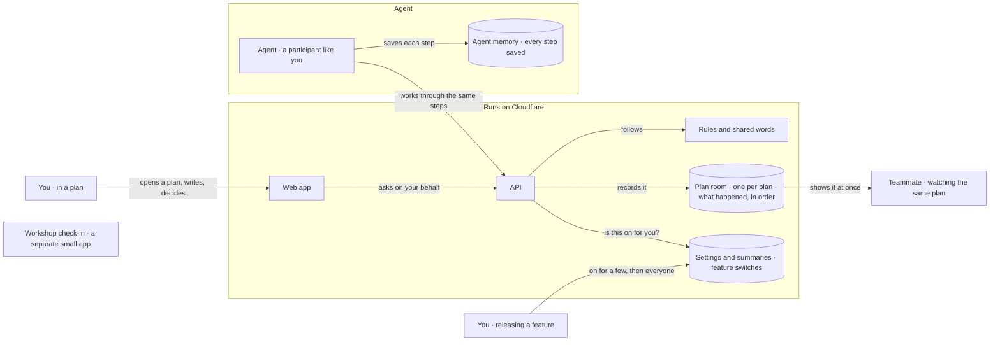

# Architecture

Two Workers joined by a service binding, one Durable Object per Plan, one D1. The event log is the system of record; everything else is a projection.

This file is the source of the architecture map. `just arch` turns the Mermaid block and the walkthrough below into `docs/architecture/index.html`, a plain-language map a person can step through. A hook runs it whenever this file changes, and refuses a new folder under `apps/` or `packages/` until the "Where it lives" table names it. The oxlint boundary rule enforces the edge that matters most today.

## Walkthrough

**Question:** What happens when someone uses Greenhouse?

The map is plain language: no file names, no code. Each row is a state a person works through, eight at most. Focus names ids from the block above; edges are written `FROM->TO`. Captions are sentences a person would say aloud.

| Step | Focus | Edges | Caption |
|---|---|---|---|
| open | P W | P->W | You open a plan in the web app and write, reply or decide. |
| ask | W A | W->A | The web app asks the API on your behalf and never touches data itself. |
| check | A D | A->D | The API checks whether this feature is switched on for you. |
| record | A RW R | A->RW A->R | If it is, the API follows the rules and the plan room records what happened. |
| share | R P2 | R->P2 | Everyone watching the plan sees the change at once, without refreshing. |
| agent | ag AG A | AG->A | The agent joins the same plan and goes through the same steps as a person. |
| resume | AG CP | AG->CP | The agent saves every step, so a crash picks up exactly where it stopped. |
| release | REL D | REL->D | A new feature starts switched off, then goes on for you, a few people, and everyone. |

## Where it lives

The map's parts, and the folders that hold them. `just arch` refuses a folder under `apps/` or `packages/` that is not in this table, so a new addition reaches the map before it reaches main.

| Part of the map | Folders |
|---|---|
| Web app | `apps/web` |
| API | `apps/api` |
| Plan room | `apps/api` (the PlanRoom Durable Object), `packages/domain` |
| Rules and shared words | `packages/domain`, `packages/schema`, `docs/GLOSSARY.md` |
| Settings and summaries | `apps/api/migrations`, `packages/db` |
| Agent | `packages/agent` |
| Agent memory | `packages/agent` (SQLite checkpoints) |
| Workshop check-in | `apps/checkin` |

## Allowed edges

| From | May import | Must not import |
|---|---|---|
| apps/web | packages/schema, the API over `env.API` | packages/domain, packages/db, any database client |
| apps/api | packages/domain, packages/schema | apps/web |
| packages/agent | @earendil-works/pi-durable, pi-ai, chord; bun:sqlite | apps/*, packages/domain (for now: a standalone harness demo) |
| apps/checkin | nothing; a standalone Worker that shares the toolchain | packages/* |
| packages/domain | packages/schema, effect | anything with I/O |
| packages/schema | effect | everything else |
| packages/db | nothing; SQL seeds run by `just seed` | everything |
| .github/workflows | runs the same `just` recipes | |

## Decisions already made

- **D1 everywhere.** Local D1 through wrangler, prod D1. Postgres through Hyperdrive is an option (a `hyperdrive` binding in `apps/api/wrangler.jsonc`), not a default.
- **The event log lives in the PlanRoom DO**, one per Plan. Single writer, strong order, append in one synchronous block. D1 holds auth, flags and cross-plan projections rebuilt by `just replay`.
- **Flags are evaluated in `decide()`**, from a D1 table read once per request and passed to the Durable Object as a list of names. A function would cross the RPC boundary as an async stub and its promise would read as true; that bug was caught by the first smoke test. Never in the web Worker. Default off.
- **Migrations never run on deploy.** `just deploy` stops if any are pending; they are applied by hand and are additive.
- **The web Worker has no data access.** It reads through the API binding. A database import under `apps/web` is a lint error.
- **`/healthz` carries two versions**: a `label` from `git describe` for people, an `id` from the version metadata binding for `wrangler rollback`. The deploy passes the label in as a var.
- **Hono is the edge, Effect is everything behind it.** `apps/api/src/services.ts`: Flags, PlanRooms and Commands are services with Layers; handlers run programs through one ManagedRuntime per env; rejections are typed errors; tests swap the D1 and Durable Object layers for in-memory ones. The vendored Effect source at `repos/effect` is read-only reference.
- **Multiplayer is the Durable Object's job.** Every open tab holds a hibernating WebSocket on the plan's object; an append broadcasts to all of them. The browser reaches the socket through the web Worker, which proxies the upgrade over the service binding.
- **Everything that runs is a `just` recipe**, so the agent and the sandbox use the same commands a person does.
