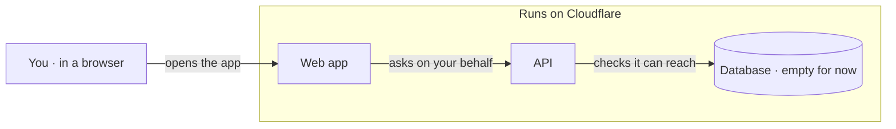

# Architecture

Two Workers joined by a service binding, and one D1. The product's shape arrives with its design (cp-02); this map shows what runs today.

This file is the source of the architecture map. `just arch` turns the Mermaid block and the walkthrough below into `docs/architecture/index.html`, a plain-language map a person can step through. A hook runs it whenever this file changes, and refuses a new folder under `apps/` or `packages/` until the "Where it lives" table names it. The oxlint boundary rule enforces the edge that matters most today.

## Walkthrough

**Question:** What runs, before the product exists?

| Step | Focus | Edges | Caption |
|---|---|---|---|
| open | P W | P->W | You open the web app; it answers before anyone has signed in. |
| ask | W A | W->A | The web app reaches the API over a private binding, never the database. |
| ready | A D | A->D | The API says it is ready only when it can reach the database. |

## Where it lives

The map's parts, and the folders that hold them. `just arch` refuses a folder under `apps/` or `packages/` that is not in this table.

| Part of the map | Folders |
|---|---|
| Web app | `apps/web` |
| API | `apps/api` |
| Database | `apps/api/migrations` |

## Allowed edges

| From | May import | Must not import |
|---|---|---|
| apps/web | the API over `env.API` | any database client |
| apps/api | effect, hono | apps/web |
| .github/workflows | runs the same `just` recipes | |
