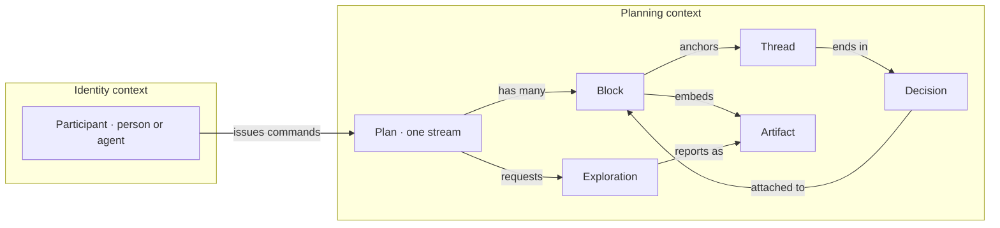

# Vocabulary map

A viz-explainer artifact of the architecture-map kind. Contexts become `subgraph`s, nouns become nodes, relationships become labelled edges. One step per noun: caption is the definition, evidence is the glossary line and the schema file. Build with `bun skills/viz-explainer/scripts/build.mjs spec.json docs/architecture/vocabulary.html`, and wire that as `just glossary`.

Mermaid shape:

Edge ids in Pele's output follow `L_<from>_<to>_<n>`, so `Thread -- ends in --> Decision` is `L_Thread_Decision_0`. The build script prints the available ids when a step names one that does not exist.

The Greenhouse spec that produced `assets/example-vocabulary-map.html` is embedded in that file's `#spec` block; copy it as the starting point for any repo and replace the nouns.

When the map has more than about twelve nouns, it is two maps, one per context, with a third map of only the cross-context edges.
