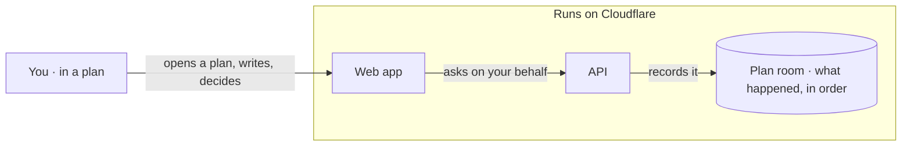
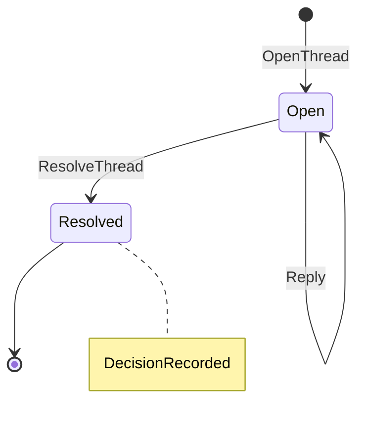
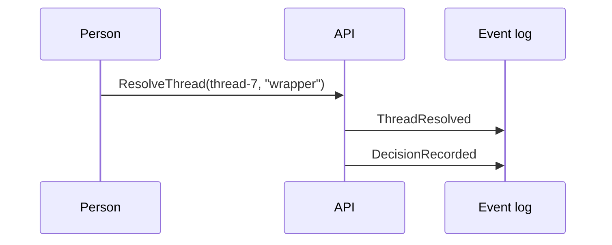

# The five kinds

Each kind answers one shape of question, replaces one habit, and maps to one pattern from Appleton's talk. Use the Mermaid starter as a shape, not a template to fill blindly.

| Kind | Question it answers | Replaces | Appleton pattern |
|---|---|---|---|
| Architecture map | Where does X live and what talks to it? | ARCHITECTURE.md paragraphs, box-and-arrow screenshots | Thick surface over a thin plan |
| State explorer | What states can this thing be in, and how does it move? | Reading a reducer to find the gap | State machine explorer |
| Event-stream story | What happened, in order, and what did each event change? | Scrolling a transcript or a log | Agent-run trace view, read as a story |
| Decision report | Which of these tried options should we take? | "Option A, B or C?" in prose | Decision report with logged ownership |
| Trace view | What did the agent touch and why? | A 3,000-line session | Mindwalk-style trace |

## Architecture map

One map per project, not one per commit or checkpoint. Its source is the project's architecture document (here `docs/ARCHITECTURE.md`): a Mermaid block, a walkthrough table and a "Where it lives" table. `just arch` builds it; a hook rebuilds it when the document changes and refuses a new app or package that has no place on it.

Plain language, no code. Nodes are the parts a person would name: "Web app", "API", "Plan room", "Agent", "Settings and summaries". No file names, function names, routes, bindings or library names in labels or captions; the build rejects labels that read like code. Edge labels say what happens in a person's words: "asks on your behalf", "records it", "shows it at once".

Steps are states a person works through, in the order they meet them: open, ask, check, record, share. A step is a moment in someone's use of the product, not a box in the diagram. Eight at most.

Where the code lives is a separate table in the source document, read by the coverage check, never drawn. Readers who want the code follow it from there.

Deep links: `index.html#record` opens on that step, which is how a slide or a PR points at one moment of the map.

## State explorer

Mermaid: `stateDiagram-v2`. Transition labels are the command names from the glossary, exactly. Notes name the events a transition records.

Steps: one per transition, in the order a real stream would take. Focus the target state and the transition edge.

The gap button: a state explorer may offer "Propose a transition". It never adds the transition itself; it posts a `proposal` to the host with from, to and the command name typed by the reader. In the product that opens a thread on the block. On stage it prints to the console.

## Event-stream story

Mermaid: `sequenceDiagram` when the point is who talked to whom; `flowchart TB` of events when the point is what each one changed. Source is an expect snapshot, a `just replay` output or a real stream.

Steps: one per event. Caption is the event read as prose: "ThreadResolved: thread 7 closed by Pratos with 'wrapper'". Focus the message or event node and the projection it touched.

## Decision report

Two or more options, each with its own diagram, compared on the same axes. The template renders one option's diagram at a time with tabs, and a comparison strip underneath.

Axes, always the same four so reports are comparable across decisions:

1. Call sites touched (count and list).
2. Mechanical changes vs judgement calls.
3. Silent behaviour changes.
4. The invariant this option risks, in glossary words.

Each option has `tried: { kind: "exploration" | "branch" | "snapshot", ref, summary }`. Untried options render disabled with "not explored yet". The "Choose" button posts `decision` to the host and locks the report, showing who and when. If the host supplies no participant, the artifact asks for a name once; it never records an anonymous decision.

For anything perceptual (spacing, motion, copy), do not build a decision report. That is an option explorer rendered against the running app, which belongs to `impeccable` and `animate`, not to a diagram.

## Trace view

Mermaid: `flowchart LR` of files and tools, grouped by package. Built from a session transcript or a pi-durable stream: each tool round is a step, the node is the file or command, and the caption is the agent's one-line reason.

Steps: at most eight. Collapse consecutive edits to one file into one step. A trace with forty steps is a transcript again.

Attach the result to the plan or PR as an artifact, next to the decision it implemented.
